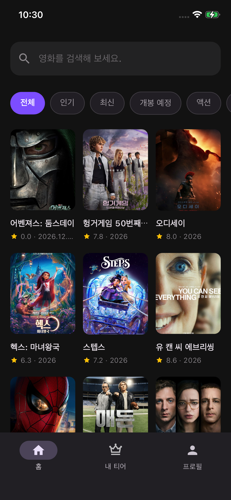
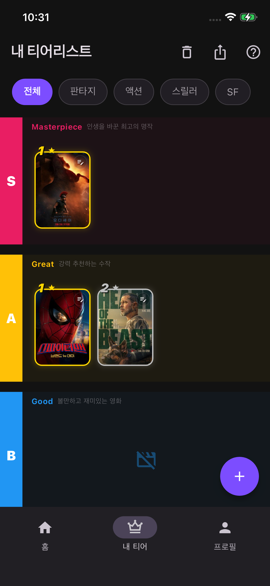
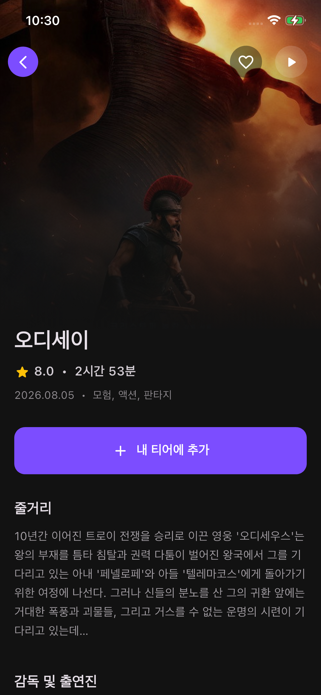
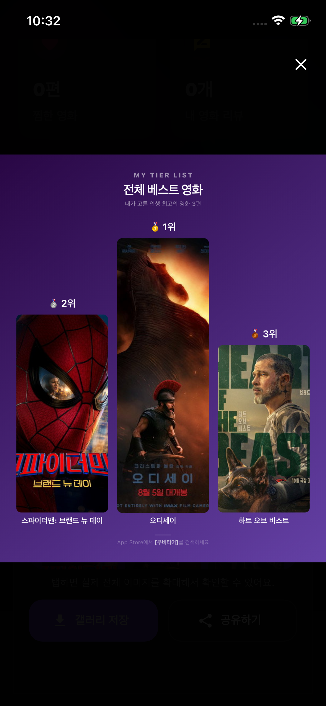
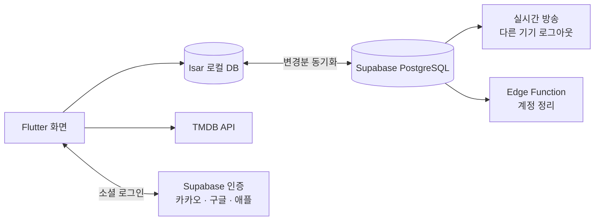

# 🎬 MovieTier (무비 티어)

[English](README.md) | **한국어**

**본 영화를 S부터 F까지 티어로 매기고, 나만의 티어표를 공유하세요.**

> 개인 프로젝트 · Flutter (iOS·Android) · 1인 개발 · 개발 중 (출시 전)

---

## 스크린샷

| 홈 | 내 티어 | 영화 상세 | 내보내기 |
| :---: | :---: | :---: | :---: |
|  |  |  |  |

---

## 소개

MovieTier는 별점보다 더 재미있게 영화를 기록하고 싶은 사람을 위한 앱입니다.
본 영화를 S, A, B, C, D, F 티어에 넣고, 티어 안에서 순서를 정하고, 한 줄 리뷰를 쓰고,
티어표를 인스타그램용 이미지로 내보낼 수 있습니다.

기획, 화면 설계, Flutter 앱, Supabase 백엔드, 스토어 출시에 필요한 약관·동의 기능까지 모두 혼자 설계하고 만들었습니다.

---

## 주요 기능

- **티어 매기기:** 영화를 S~F 티어에 넣고 티어 안에서 순서 조정
- **영화 검색과 탐색:** TMDB API의 트렌딩, 인기, 현재 상영, 개봉 예정, 장르별 목록. 사용자 국가에 맞는 개봉일 표시
- **영화 상세:** 상영 시간, 장르, 감독, 주요 출연진, 공식 예고편
- **리뷰와 찜 목록:** 한 줄 리뷰, "보고 싶은 영화" 목록
- **이미지 내보내기:** 티어표, Top 3, 연간 결산을 인스타그램 스토리(9:16)나 피드(4:5) 이미지로 저장. 영화가 많으면 여러 장으로 자동 분할
- **배지:** 감상 성향(장르, 고전 영화, 긴 영화, S티어 등)에 따라 배지 지급
- **소셜 로그인:** 카카오, 구글, 애플 로그인. 로그인 전에는 게스트 모드
- **오프라인 우선:** 인터넷이 없어도 앱이 동작하고, 연결되면 자동 동기화

---

## 기술 스택

| 분야 | 기술 |
| --- | --- |
| 프레임워크 | Flutter, Dart 3 |
| 로컬 DB | Isar |
| 백엔드 | Supabase (인증, PostgreSQL, 실시간, Edge Functions) |
| Edge Functions | TypeScript (Deno) |
| 네트워크 | http, TMDB REST API |
| 보안 | envied (환경 변수 난독화) |
| UI | flutter_screenutil, google_fonts, lottie, cached_network_image, flutter_svg |
| 공유 | screenshot, share_plus, saver_gallery |

---

## 구조

---

## 기술적으로 신경 쓴 부분

**1. 오프라인 우선 증분 동기화**
- 모든 변경을 먼저 로컬 DB에 저장해서 인터넷 없이도 앱이 동작합니다.
- 바뀐 데이터에 "변경됨" 표시를 하고, 연결이 돌아오면 그것만 업로드합니다.
- 삭제는 "삭제 표시(툼스톤)" 방식이라, 다음 동기화 때 지운 영화가 다시 살아나지 않습니다.

**2. 기기 간 단일 로그인 세션**
- 새 기기에서 로그인하면 Supabase 실시간 방송으로 다른 기기를 즉시 로그아웃시킵니다.
- 앱 실행 시와 인터넷 재연결 시에도 세션을 확인해서, 신호를 놓쳐도 처리됩니다.
- 실시간 채널의 토큰 갱신 타이밍 오류는 자동으로 재시도합니다.

**3. SNS용 이미지 내보내기**
- 티어표를 고정 크기 이미지로 그립니다 (스토리 1080×1920, 피드 1080×1350).
- 영화가 많으면 포스터가 잘 보이도록 고화질 여러 장으로 나눕니다.
- 갤러리 저장 시 Android 버전별 저장 권한 차이를 처리합니다.

**4. 스토어 출시를 위한 약관·동의 기능**
- 약관과 개인정보처리방침은 Supabase에서 먼저 불러오고, 실패하면 캐시, 그다음 앱 내장 파일 순으로 불러옵니다.
- 새 사용자는 로그인 후 약관에 동의해야 하며, 끝까지 동의하지 않은 계정은 Supabase Edge Function이 정리합니다.

**5. 비밀 정보 관리**
- API 키는 환경 변수와 난독화(envied)로 소스 코드에서 분리했습니다.

---

## 내가 한 일

- 서비스 기획, 화면과 사용 흐름 설계
- iOS·Android용 Flutter 앱 개발
- Supabase 데이터베이스, 인증, 실시간 세션 로직 설계
- TypeScript로 Supabase Edge Function 작성
- 스토어 제출용 개인정보처리방침과 이용약관 준비

---

## 진행 상황과 다음 단계

- [x] 핵심 기능: 티어, 검색, 상세, 리뷰, 찜, 내보내기, 배지
- [x] 소셜 로그인, 오프라인 우선 동기화
- [ ] 앱스토어·구글 플레이 출시
- [ ] 단위·위젯 테스트
- [ ] GitHub Actions로 CI/CD

---

## 참고

소스 코드는 출시 전까지 비공개입니다. 요청하시면 코드를 함께 보며 설명드릴 수 있습니다.

이 앱은 TMDB API를 사용하지만 TMDB의 보증이나 인증을 받은 것은 아닙니다.
