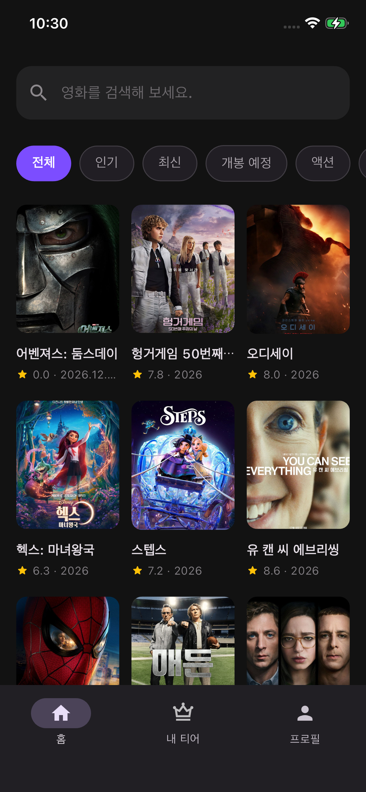
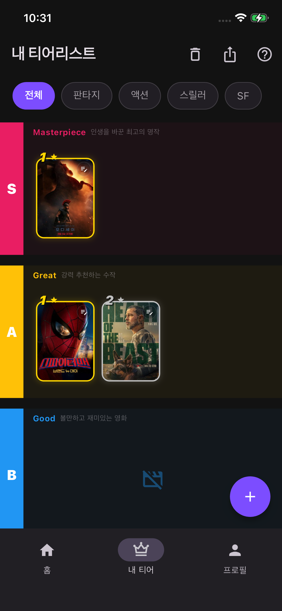
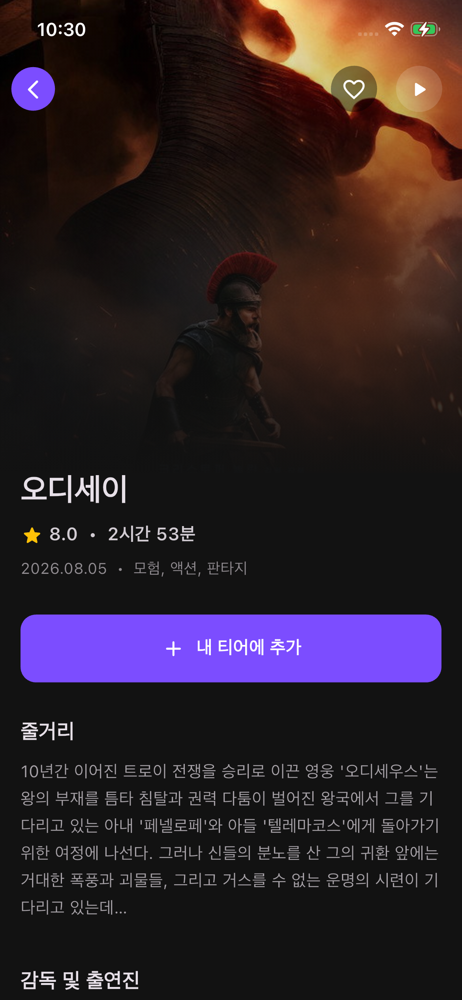
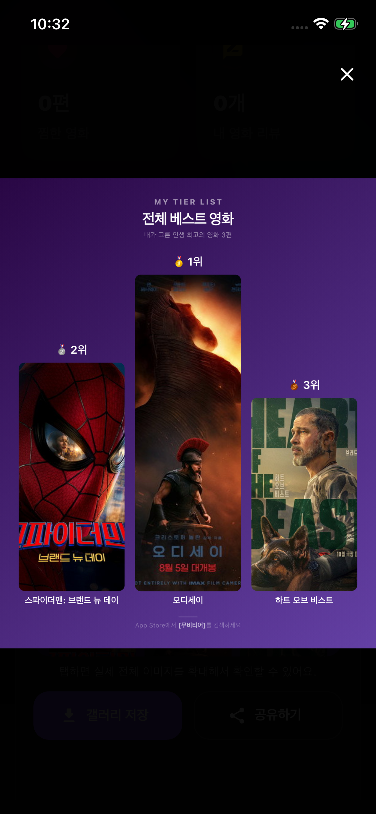
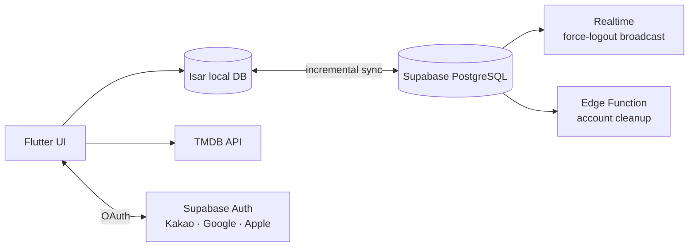

# 🎬 MovieTier

**English** | [한국어](README.ko.md)

**Rank every movie you've watched, from S to F, and share your tier list.**

> Personal project · Flutter (iOS & Android) · Solo developer · In development (pre-release)

---

## Screenshots

| Home | My Tier | Movie Detail | Export |
| :---: | :---: | :---: | :---: |
|  |  |  |  |

---

## About

MovieTier is a mobile app for movie fans who want more than a star rating.
Users place each movie they have watched into a tier (S, A, B, C, D, F), order movies within each tier,
write one-line reviews, and export their tier list as an image for Instagram.

I designed and built the whole app on my own: product planning, UI, the Flutter client,
the Supabase backend and the legal and consent flows needed for store release.

---

## Key Features

- **Tier ranking:** Place movies into S–F tiers and reorder them within each tier
- **Movie search and discovery:** Trending, popular, now playing, upcoming and genre lists from the TMDB API,
  with release dates matched to the user's country
- **Movie details:** Runtime, genres, director, top cast and official trailer
- **Reviews and watchlist:** One-line reviews and a "want to watch" list
- **Image export:** Tier lists, Top 3 and yearly recaps rendered as Instagram Story (9:16) or Feed (4:5) images,
  with automatic multi-slide splitting for large lists
- **Badges:** Badges earned from viewing habits (genres, classics, long movies, S-tier picks and more)
- **Social login:** Kakao, Google and Apple sign-in, with a guest mode before login
- **Offline-first:** The app works offline and syncs when the connection returns

---

## Tech Stack

| Area | Technology |
| --- | --- |
| Framework | Flutter, Dart 3 |
| Local database | Isar |
| Backend | Supabase (Auth, PostgreSQL, Realtime, Edge Functions) |
| Edge Functions | TypeScript (Deno) |
| Networking | http, TMDB REST API |
| Security | envied (obfuscated environment variables) |
| UI | flutter_screenutil, google_fonts, lottie, cached_network_image, flutter_svg |
| Sharing | screenshot, share_plus, saver_gallery |

---

## Architecture

---

## Technical Highlights

**1. Offline-first incremental sync**
- Every change is saved to the local Isar database first, so the app works without a network.
- Changed records are marked as "dirty" and only those are uploaded when the connection returns.
- Deletes use tombstones (a deleted flag and timestamp) so removed movies do not reappear after the next sync.

**2. Single active session across devices**
- When a user signs in on a new device, the other device is signed out in real time
  through a Supabase Realtime broadcast.
- The app also checks the active session on launch and on reconnect, so a missed signal is still handled.
- Token-refresh timing errors on the realtime channel are retried automatically.

**3. Image export for social media**
- Tier lists are rendered as fixed-size images (1080×1920 for Story, 1080×1350 for Feed).
- Large tier lists are split into high-resolution slides so posters stay readable.
- Saving to the gallery handles Android version differences in storage permissions.

**4. Store-ready legal and consent flow**
- Terms and privacy policy are loaded from Supabase first, then from a local cache,
  then from bundled assets if the network is slow or offline.
- New users must accept the terms after signing in. A Supabase Edge Function removes
  accounts that never accepted them.

**5. Secret management**
- API keys (Supabase and TMDB) are kept out of source code using environment variables with obfuscation (envied).

---

## What I Did

- Planned the product and designed the UI and user flows
- Built the Flutter app for both iOS and Android
- Designed the Supabase database, authentication and realtime session logic
- Wrote a Supabase Edge Function in TypeScript
- Prepared the privacy policy and terms of service for store submission

---

## Status and Next Steps

- [x] Core features: tier ranking, search, details, reviews, watchlist, export, badges
- [x] Social login and offline-first sync
- [ ] App Store and Google Play release
- [ ] Unit and widget tests
- [ ] CI/CD with GitHub Actions

---

## Note

The source code is kept private until release. I am happy to walk through the code on request.

This product uses the TMDB API but is not endorsed or certified by TMDB.
